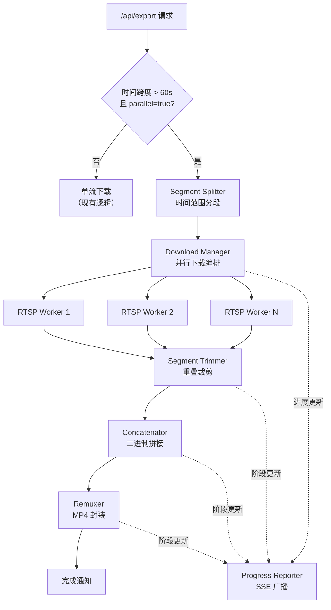
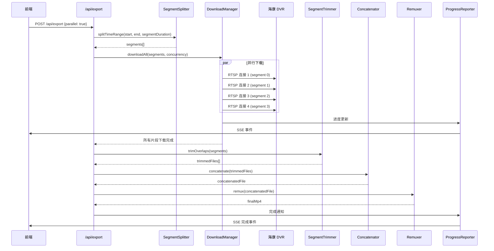
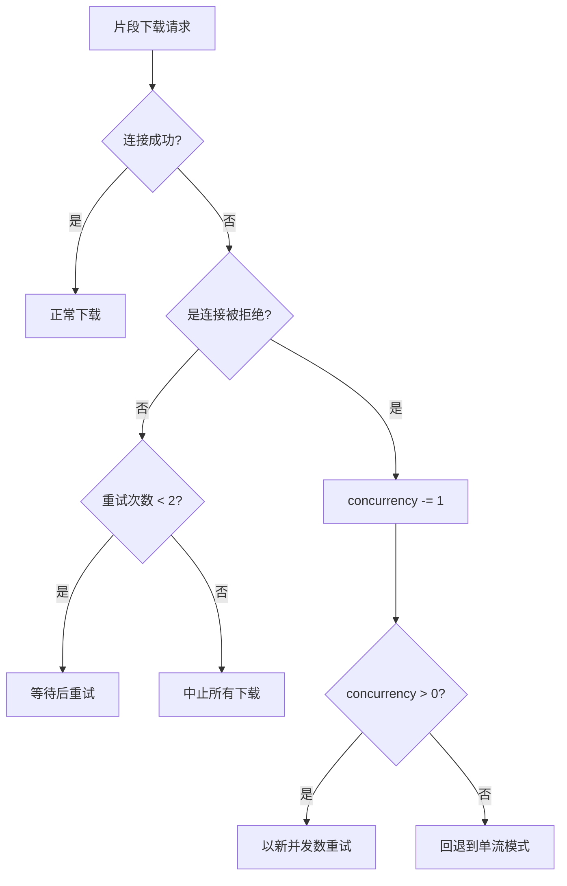

# 技术设计文档：并行分段下载

## 概述

本设计为海康威视 DVR 视频下载器实现并行分段下载功能。核心思路是将用户请求的时间范围拆分为多个较短的片段，通过多个 RTSP 连接并发下载，然后裁剪重叠、拼接、封装为最终 MP4 文件。

当前系统通过单个 RTSP 连接以约 1x 实时速率下载视频。并行方案利用 DVR 支持的多路并发连接（通常 4-8 路），将导出时间缩短 3-6 倍。

### 设计决策

1. **原始 Annex B 格式作为中间存储**：避免容器格式的时间戳问题，支持简单的二进制拼接。
2. **重叠裁剪策略**：每段开头增加重叠时间，裁剪时从 I 帧开始截取，确保无帧丢失。
3. **并发池模式**：使用固定大小的并发池控制 RTSP 连接数，避免超出 DVR 限制。
4. **渐进式回退**：连接被拒时自动降低并发数，最终可回退到单流模式。

## 架构

### 系统架构图



### 处理流水线



## 组件与接口

### 模块结构

```
server.js                    # 现有入口，修改 /api/export 路由
lib/
  parallel-download.js       # 并行下载管线主入口
  segment-splitter.js        # 时间范围分段逻辑
  download-manager.js        # 并发下载编排
  segment-trimmer.js         # 重叠裁剪
  concatenator.js            # 二进制拼接
  remuxer.js                 # MP4 封装（提取自现有逻辑）
  progress-reporter.js       # 进度汇总与广播
```

### 接口定义

#### SegmentSplitter

```typescript
interface TimeSegment {
  index: number;           // 片段序号（0-based）
  startTime: string;       // Hikvision 格式: "20231012T080000Z"
  endTime: string;         // Hikvision 格式: "20231012T080200Z"
  originalStart: string;   // 不含重叠的原始起始时间
  originalEnd: string;     // 不含重叠的原始结束时间
  isFirst: boolean;        // 是否为第一段
  isLast: boolean;         // 是否为最后一段
  overlapBefore: number;   // 开头重叠秒数
  overlapAfter: number;    // 结尾重叠秒数
}

function splitTimeRange(
  startTime: string,       // "20231012T080000Z"
  endTime: string,         // "20231012T100000Z"
  segmentDuration: number, // 秒，默认 120，最小 30
  overlapDuration: number  // 秒，默认 3
): TimeSegment[]
```

#### DownloadManager

```typescript
interface DownloadOptions {
  ip: string;
  user: string;
  pass: string;
  channel: string;
  segments: TimeSegment[];
  concurrency: number;     // 1-8，默认 4
  codec: string;           // "h264" | "hevc"
  outputDir: string;
  onProgress: (progress: ProgressUpdate) => void;
}

interface SegmentResult {
  index: number;
  filePath: string;
  fileSize: number;
  success: boolean;
  retries: number;
}

interface ProgressUpdate {
  phase: string;           // "downloading" | "trimming" | "concatenating" | "remuxing"
  overallPercent: number;  // 0-100
  segmentsCompleted: number;
  segmentsTotal: number;
  segmentsInProgress: number[];
  currentRetry?: { segment: number; attempt: number };
  message: string;
}

async function downloadAll(options: DownloadOptions): Promise<SegmentResult[]>
```

#### SegmentTrimmer

```typescript
interface TrimResult {
  index: number;
  trimmedPath: string;
  bytesRemoved: number;
}

async function trimOverlaps(
  segments: TimeSegment[],
  segmentFiles: SegmentResult[],
  codec: string,           // "h264" | "hevc"
  overlapDuration: number  // 秒
): Promise<TrimResult[]>
```

#### Concatenator

```typescript
async function concatenate(
  trimmedFiles: TrimResult[],  // 按 index 排序
  outputPath: string
): Promise<string>  // 返回输出文件路径
```

#### Remuxer

```typescript
interface RemuxOptions {
  inputPath: string;
  outputPath: string;
  frameRate: number;       // 默认 20
  faststart: boolean;      // 默认 true
}

async function remux(options: RemuxOptions): Promise<string>
```

#### ProgressReporter

```typescript
// 复用现有 broadcastProgress 机制，扩展消息格式
function reportParallelProgress(
  taskId: string,
  update: ProgressUpdate
): void
```

### API 接口变更

现有 `POST /api/export` 请求体扩展：

```json
{
  "ip": "192.168.1.64",
  "user": "admin",
  "pass": "password",
  "channel": "101",
  "startTime": "20231012T080000Z",
  "endTime": "20231012T100000Z",
  "parallel": true,
  "concurrency": 4,
  "segmentDuration": 120
}
```

新增字段均为可选，默认值：
- `parallel`: `true`
- `concurrency`: `4`
- `segmentDuration`: `120`

## 数据模型

### 文件命名约定

```
downloads/
  ch101_20231012T080000Z_to_20231012T100000Z_seg000.h264   # 片段 0 原始
  ch101_20231012T080000Z_to_20231012T100000Z_seg001.h264   # 片段 1 原始
  ch101_20231012T080000Z_to_20231012T100000Z_seg001_trimmed.h264  # 片段 1 裁剪后
  ch101_20231012T080000Z_to_20231012T100000Z_concat.h264   # 拼接结果
  ch101_20231012T080000Z_to_20231012T100000Z.mp4           # 最终输出
```

### 内部状态模型

```typescript
interface ExportTask {
  taskId: string;
  status: 'segmenting' | 'downloading' | 'trimming' | 'concatenating' | 'remuxing' | 'completed' | 'error' | 'cancelled';
  segments: TimeSegment[];
  segmentResults: Map<number, SegmentResult>;
  codec: string;
  concurrency: number;
  overlapDuration: number;
  outputPath: string;
  intermediateFiles: string[];  // 用于清理
  error?: string;
  startedAt: Date;
}

interface SegmentDownloadState {
  index: number;
  status: 'queued' | 'downloading' | 'completed' | 'failed' | 'retrying';
  retryCount: number;
  bytesReceived: number;
  ffmpegProcess?: ChildProcess;
}
```

### NAL Unit 结构（用于裁剪）

H.264 和 HEVC Annex B 格式使用起始码分隔 NAL 单元：

```
[0x00 0x00 0x00 0x01] [NAL Header] [NAL Payload]
  起始码 (4 bytes)      类型标识       数据
```

裁剪逻辑需要识别的 NAL 类型：
- H.264: `nal_unit_type = 5` (IDR slice, I 帧)
- HEVC: `nal_unit_type = 19 或 20` (IDR_W_RADL / IDR_N_LP)

### 进度计算模型

```
总进度 = 下载阶段权重(85%) + 裁剪阶段权重(5%) + 拼接阶段权重(3%) + 封装阶段权重(7%)

下载进度 = Σ(各片段已接收字节) / Σ(各片段估计总字节)
估计总字节 = 片段时长(秒) × 平均比特率 / 8
平均比特率 = 第一个完成片段的实际大小 / 片段时长（动态校准）
```

## 正确性属性（Correctness Properties）

*属性（Property）是在系统所有有效执行中都应成立的特征或行为——本质上是对系统应做什么的形式化陈述。属性是人类可读规格与机器可验证正确性保证之间的桥梁。*

### Property 1: 片段完整覆盖

*For any* 有效的时间范围（起始时间 < 结束时间），Segment_Splitter 生成的片段的原始时间范围（不含重叠）应完整覆盖输入时间范围，无间隙无重复，且除最后一段外每段长度等于 segmentDuration。

**Validates: Requirements 1.1**

### Property 2: 重叠扩展正确性

*For any* 生成的片段集合，除第一段外的每个片段的实际起始时间应比其原始起始时间早 overlapDuration 秒；除最后一段外的每个片段的实际结束时间应比其原始结束时间晚 overlapDuration 秒。

**Validates: Requirements 1.2, 1.3**

### Property 3: 整秒对齐

*For any* 输入参数组合，Segment_Splitter 生成的所有片段时间边界（startTime 和 endTime）均应对齐到整秒，不含亚秒精度。

**Validates: Requirements 1.5**

### Property 4: 短时间范围不分段

*For any* 时间跨度为 60 秒或更短的时间范围，Segment_Splitter 应返回恰好一个片段，该片段覆盖完整的输入范围且无重叠扩展。

**Validates: Requirements 1.4, 8.1**

### Property 5: 并发不超限

*For any* 片段数量和并发限制组合，Download_Manager 在任何时刻的活跃 RTSP 连接数不应超过当前的 Concurrency_Limit。

**Validates: Requirements 2.1, 7.1**

### Property 6: 失败重试上限

*For any* 下载失败的片段，Download_Manager 应对其重试恰好不超过 2 次，总尝试次数不超过 3 次。

**Validates: Requirements 2.3**

### Property 7: 重试耗尽后中止

*For any* 在所有重试后仍失败的片段，Download_Manager 应中止所有剩余的排队和进行中的下载。

**Validates: Requirements 2.4**

### Property 8: 裁剪从 I 帧开始

*For any* 非首段的 Annex B 流，Segment_Trimmer 的裁剪结果应从 overlap_duration 时间点处或之后的第一个 I 帧开始（如果在 2 秒内找到 I 帧）。

**Validates: Requirements 3.1, 3.2**

### Property 9: 裁剪保持格式

*For any* 经过裁剪的 Annex B 流，输出应仍为有效的 Annex B 格式（以起始码开头，包含有效的 NAL 单元结构）。

**Validates: Requirements 3.4**

### Property 10: 拼接顺序正确

*For any* 一组有序的二进制片段，Concatenator 的输出应等于按索引顺序依次拼接各片段的结果。

**Validates: Requirements 4.1**

### Property 11: 缺失片段检测

*For any* 包含缺失或零字节文件的片段集合，Concatenator 应报告错误并正确标识所有缺失的片段索引。

**Validates: Requirements 4.4**

### Property 12: 进度百分比计算

*For any* 各片段的已接收字节数和估计总字节数，Progress_Reporter 计算的汇总进度百分比应等于 (已接收总字节 / 估计总字节) × 下载阶段权重，且结果在 0-100 范围内。

**Validates: Requirements 6.1**

### Property 13: 连接拒绝时自适应降级

*For any* DVR 拒绝连接的情况，Download_Manager 应将当前任务的 Concurrency_Limit 减 1 并重试被拒绝的片段，直到并发降为 0。

**Validates: Requirements 7.4**

### Property 14: 全部拒绝时回退顺序模式

*For any* 所有并行连接尝试均因拒绝而失败的情况（并发降至 0），Download_Manager 应回退到单流顺序下载模式。

**Validates: Requirements 8.2**

### Property 15: 失败或取消时清理中间文件

*For any* 在管线任意阶段发生失败或用户取消的情况，Download_Manager 应删除该次导出创建的所有中间片段文件，但不删除已成功生成的最终 MP4 文件。

**Validates: Requirements 9.1, 9.2, 9.3**

## 错误处理

### 错误分类与处理策略

| 错误类型 | 处理策略 | 用户反馈 |
|---------|---------|---------|
| RTSP 连接超时 | 重试（最多 2 次），超时时间递增 | "片段 X 连接超时，正在重试..." |
| RTSP 连接被拒绝 | 降低并发数，重试该片段 | "连接被拒绝，降低并发至 N..." |
| 所有连接被拒绝 | 回退到单流模式 | "并行下载不可用，已切换为单流模式" |
| ffmpeg 进程崩溃 | 重试该片段 | "片段 X 下载异常，正在重试..." |
| 磁盘空间不足 | 立即中止，清理已下载文件 | "磁盘空间不足，导出已中止" |
| 片段文件损坏（0 字节） | 重试该片段 | "片段 X 数据异常，正在重试..." |
| 裁剪失败（无 I 帧） | 使用字节边界回退裁剪 | 静默处理，不通知用户 |
| 拼接失败 | 中止并清理 | "视频拼接失败，请重试" |
| 封装失败 | 中止，保留拼接文件供调试 | "MP4 封装失败，请查看日志" |

### 连接拒绝自适应逻辑



### 取消机制

用户取消导出时的处理流程：
1. 设置 `task.status = 'cancelled'`
2. 向所有活跃的 ffmpeg 子进程发送 SIGTERM
3. 等待进程退出（最多 5 秒，否则 SIGKILL）
4. 删除所有中间文件（`*_seg*.h264`, `*_trimmed.h264`, `*_concat.h264`）
5. 通过 SSE 广播取消状态

## 测试策略

### 测试方法

本功能采用双重测试策略：

1. **属性测试（Property-Based Testing）**：验证核心算法逻辑的普遍正确性
2. **单元测试（Unit Tests）**：验证特定示例、边界条件和错误处理
3. **集成测试（Integration Tests）**：验证与 ffmpeg/ffprobe 和 RTSP 的交互

### 属性测试配置

- **测试框架**：[fast-check](https://github.com/dubzzz/fast-check)（Node.js 生态最成熟的 PBT 库）
- **测试运行器**：Node.js 内置 test runner（`node --test`）
- **最小迭代次数**：每个属性测试 100 次
- **标签格式**：`Feature: parallel-segment-download, Property {N}: {property_text}`

### 属性测试覆盖

| Property | 测试目标 | 生成器 |
|----------|---------|--------|
| 1: 片段完整覆盖 | `splitTimeRange()` | 随机时间范围（61s-86400s）、随机 segmentDuration（30-600s） |
| 2: 重叠扩展正确性 | `splitTimeRange()` | 同上 + 随机 overlapDuration（1-10s） |
| 3: 整秒对齐 | `splitTimeRange()` | 同上 |
| 4: 短时间范围不分段 | `splitTimeRange()` | 随机时间范围（1-60s） |
| 5: 并发不超限 | `downloadAll()` (mocked) | 随机片段数（1-20）、随机并发（1-8）、随机下载时长 |
| 6: 失败重试上限 | `downloadAll()` (mocked) | 随机失败模式 |
| 7: 重试耗尽后中止 | `downloadAll()` (mocked) | 持续失败场景 |
| 8: 裁剪从 I 帧开始 | `trimOverlaps()` | 合成 Annex B 流，随机 I 帧位置 |
| 9: 裁剪保持格式 | `trimOverlaps()` | 合成 Annex B 流 |
| 10: 拼接顺序正确 | `concatenate()` | 随机二进制 Buffer 数组 |
| 11: 缺失片段检测 | `concatenate()` | 随机缺失/空文件组合 |
| 12: 进度百分比计算 | `calculateProgress()` | 随机字节数组合 |
| 13: 连接拒绝自适应 | `downloadAll()` (mocked) | 随机拒绝模式 |
| 14: 全部拒绝回退 | `downloadAll()` (mocked) | 全部拒绝场景 |
| 15: 清理中间文件 | `downloadAll()` (mocked) | 随机失败点 |

### 单元测试覆盖

- 默认参数值验证（concurrency=4, segmentDuration=120, overlap=3）
- 参数边界验证（segmentDuration < 30 拒绝, concurrency 范围 1-8）
- API 参数解析（parallel, concurrency, segmentDuration 可选参数）
- 进度消息格式（各阶段标签、重试计数显示）
- 文件命名约定
- SSE 事件格式兼容性

### 集成测试覆盖

- ffprobe 编码检测（H.264 / HEVC）
- ffmpeg Annex B 提取（实际 RTSP 流或测试文件）
- ffmpeg MP4 封装（-r 20, -movflags +faststart）
- 端到端管线（短时间范围，验证最终 MP4 可播放）

